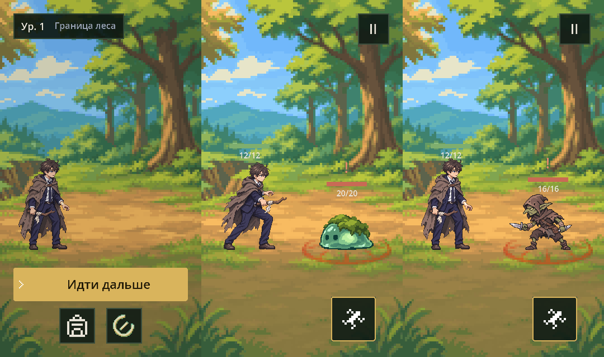

# Анимации текущей игры — 20 ноября 2026

Реализованы и подключены 15 клипов / 49 кадров из текущих потребителей ArtMap. Подготовлены 10 новых боевых листов через встроенный image_gen; 5 клипов пролога восстановлены из существующих больших AI-исходников. Маленькие PNG не увеличивались. Выбор пригодных версий выполнен агентом в рамках поручения пользователя реализовать текущие анимации; это не отдельное утверждение пользователем каждого кадра.

## Состав

| Семейство | Клипы | Кадры | Способ |
|---|---|---:|---|
| Харуто после изгнания | idle 2, branch_attack 4, dodge 4, hit 2 | 12 | Новая генерация от качественного still с прутом |
| Моховая слизь | idle 2, jump 6, hit 2 | 10 | Новая генерация от качественного still |
| Гоблин-лазутчик | idle 2, double_slash 6, retreat 3 | 11 | Новая генерация от большого оригинала; оба кинжала в руках во всех фазах |
| Харуто современный | push 4 | 4 | Большие оригиналы сохранённых поз |
| Юи | wait 2, step 4 | 6 | Большие оригиналы, единый масштаб семейства |
| Мицуки | offer 3, wing_glitch 3 | 6 | Большие оригиналы story-клипов, общий ракурс |

Под «текущими» здесь понимаются клипы, которые загружают Combat/Prologue: 10 боевых и 5 пролога. Оверлей push подавляется в некоторых сюжетных планах, где герой уже нарисован; это правило сохранено. Modern alarm/run и Yui displaced объявлены в ArtMap, но текущий Prologue их не запрашивает. Modern walk и ещё 33 клипа существуют в production-каталоге, но не подключены к этим потребителям. [План дальнейшей работы для ChatGPT](CHATGPT_ANIMATION_PRODUCTION_PLAN.md) отделяет их от действительно отсутствующих анимаций.

## Интеграция

Production PNG находятся по прежним путям `assets/characters/animations/` и `assets/enemies/animations/`. `assets/manifest.json` содержит новые размеры, SHA-256, происхождение каждого кадра, source crops, registration, atlas regions, margins и runtime scale. Старые версии и прежний manifest сохранены в `art_working/animation_upgrade_2026_11_20/backup/`.

`tools/copy_art.py` сверяет утверждённые PNG и генерирует `game/art/animation_catalog.json` из runtime-полей manifest. Это производный файл, не второе место ручного редактирования. ArtMap использует импортированные Texture2D, trimmed regions и виртуальные поля; **больше нельзя нарезать эти 15 файлов как прежнюю горизонтальную полосу**. Старый интерфейс и прежняя нарезка остаются для ещё не обновлённых клипов.

Combat применяет scale/offset при смене каждого клипа. World показывает точный нулевой кадр нового idle, поэтому между миром и боем нет переключения на маленькую версию. Prologue сохраняет прежнее центрирование актёрского canvas; полноэкранные кадры Мицуки центрируются отдельно. Число кадров, существующие fps и события боевого resolver не менялись. Представление не наносит урон.

Во время проверки обнаружены потребители, обращавшиеся к `completed_encounter_ids` как к полю при уже существующем одноимённом методе. В World и двух GUI-review helpers добавлен вызов метода; доменная реализация не менялась.

## Техническая обработка

Полные запросы: `art_working/animation_upgrade_2026_11_20/prompts/`; исходные результаты встроенного генератора и архивные оригиналы: `source/`; воспроизводимая сборка: `tools/build_animation_upgrade.py`. Модель/seed инструментом не сообщены и не записывались как известные.

Генератор дал листы реального размера 1024×1536, 1448×1086 и других размеров; размеры из текста запроса не выдаются за фактические. Кадры сохранены в исходном разрешении: только crop/registration/packing. У новых непрозрачных боевых персонажей убраны alpha<224 вокруг силуэта и отсоединённые фрагменты соседних поз. RGB оставшихся областей не перерисован, палитра не сокращалась; alpha внутри crop старых исходников пролога сохранена. Это подготовленные растровые AI-спрайты, не утверждение идеальной ручной пиксельной сетки.

У всех кадров клипа один масштаб; отсутствует автоматическое независимое подгоняние каждой позы по высоте. Для прыжка слизи и отскока гоблина записано намеренное поднятие над общей опорой. Выступающий прут в follow-through разрезан по проверенной границе, затем лист упакован заново. Все atlas меньше 4096 по каждой стороне. Lossless, mipmaps off, size limit 0; nearest наследуется из проекта.

## Проверки

- 15/15 PNG прошли `create-game-assets/scripts/asset_report.py`: фактические размеры, настоящий alpha для cutout. Палитра намеренно не ограничивалась старым лимитом цветов.
- 49/49 кадров: побайтово проверены native RGB, для переиспользованных поз также исходный RGBA. Проверены registration и намеренная высота полёта.
- `animation_assets_runner.gd`: **238 проверок, 0 ошибок**, 15 клипов / 49 кадров. Проверены frame counts, виртуальный canvas, atlas bounds, loop policy, scale на реальных Combat-потребителях и центрирование пролога.
- Все 69 GDScript в итоговом снимке проекта компилируются, broken=0. Окружение печатает предупреждение certificate store; оно сохранено в логах и не считается проверкой ассетов.
- **56 GPU-снимков** настоящих сцен Godot Compatibility / GTX 1050 Ti: все 49 поз, World и idle двух боёв в 360×640, 720×1280, 1080×1920. Использован SubViewport нужного размера; 1080 не получен увеличением маленького снимка. Просмотрены contact sheets, ключевые позы в сценах и alpha на светлом/тёмном фоне. Это визуальные fixtures с остановленной симуляцией, не полный input-playthrough.
- `copy_art.py` после продвижения: все 53 PNG проверены; повторный запуск — 0 копирований. Каталог 15 runtime-контрактов воспроизводится из manifest.
- Итоговый общий domain runner после параллельных gameplay-правок: **59 passed / 0 failed / 0 unfinished**. Баланс/сохранение в задаче ассетов не изменялись. Прогон изолирован через переменные окружения дочернего процесса, тестовый user:// находится внутри рабочего пакета. Проверена и отрицательная ветка asset runner: намеренный failure даёт exit 1.

Расчёт RGBA8 только для активных atlas: бой со слизью **28,66 MiB**, с гоблином **31,35 MiB**, пять заранее загружаемых клипов пролога **72,99 MiB**. Это арифметика по текстурам, без фонов, UI, драйвера, копий и других ресурсов. Не является замером GPU-памяти или Android-профилем. В дальнейшем можно лениво загружать story-клипы; уменьшать masters автоматически не нужно.

## Материалы для просмотра

- [Анимации Харуто](../reviews/animation_upgrade_2026_11_20/hero_actions.gif), [слизи](../reviews/animation_upgrade_2026_11_20/slime_actions.gif), [гоблина](../reviews/animation_upgrade_2026_11_20/goblin_actions.gif).
- [Все кадры](../reviews/animation_upgrade_2026_11_20/all_frames_contact.png), [alpha](../reviews/animation_upgrade_2026_11_20/alpha_light_dark.png), [машинный QA](../reviews/animation_upgrade_2026_11_20/qa_report.json).
- [Бой 1080×1920](../reviews/animation_upgrade_2026_11_20/moss_slime_idle_1080x1920.png), [Мицуки](../reviews/animation_upgrade_2026_11_20/prologue_offer_00.png).

GIF — уменьшенные превью реальных GPU-кадров, не production-исходники. Художественные ограничения: небольшие различия лица/складок между AI-позами и выразительность hand-drawn промежуточных кадров требуют дальнейшего просмотра; defeat, ходьба и оружейные варианты не добавлялись. Android, экспорт и FPS на телефоне не проверены. Основной лесной фон в рамках этой задачи не заменялся; отдельный пакет его полноразмерной замены остаётся актуален.
