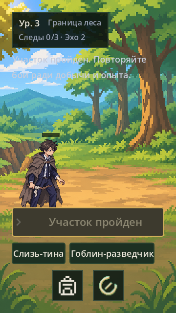

# Артефакты повторного аудита — 20.11.2026

[Выводы и приоритеты](../../design/FOLLOWUP_UX_GAMEPLAY_AUDIT_2026_11_20.md), [следующий prompt Kimi](../../design/KIMI_FEEL_AND_GAMEPLAY_FOLLOWUP_PROMPT.md).

## Живой прогон

Godot 4.7.2 Compatibility, окно 360×640 / logical180×320, запуск managed process с `held:true` (fixed60). Основной run `ff2edff2`, изолированный `--save-path=user://followup_audit_held_20261120.json`; начальный проверочный процесс `dbc28e8c` имел другой изолированный путь. Оба остановлены. Нулевые ошибки/предупреждения основного прогона проверены перед остановкой. Exit1 при stop означает принудительную остановку MCP, не игровой crash.

Последовательность настоящим GUI-вводом: «Начать путь» → Skip → «Идти дальше» → слизь без боевого ввода → автоматическая победа/выдача → World → «Идти дальше» → гоблин без боевого ввода → конец участка. Сцены не подменялись fixture-маршрутизацией. Между вводом сделаны точные шаги движка; GPU-снимки сохранялись без изменения игрового состояния. Первый click_node был послан до layout, не попал в экран; после 4frames повторён успешно. Это ошибка настройки прогона, не продуктовый finding.

| Кадр и состояние | Что показывает |
|---|---|
| [Пролог](runtime_prologue.png), [state](runtime_prologue.json) | Реальный Skip и dialogue layout; полный пролог этим прогоном не прочитан |
| [World до боя](runtime_world.png), [state](runtime_world.json) | Начальный участок, уровень 1 |
| [Замах без анимации](runtime_auto_attack.png), [state](runtime_auto_attack.json) | Combat tick12: hero idle, у hero_attack_begun0 подписчиков |
| [Победа](runtime_victory.png), [state](runtime_victory.json) | Tick259, враг 0HP, герой 9HP, уровень 2, добыча уже в inventory; обрезанная строка роста |
| [World после победы](runtime_world_after_victory.png), [state](runtime_world_after_victory.json) | Toast исчез вместе со сценой, RepeatRow поднял CTA на ноги героя |
| [Конец участка](runtime_route_end.png), [state](runtime_route_end.json) | Уровень 3, два pending upgrades; CTA y212…242 при ногах y224; beaten в памяти 2, на диске 1 |

## Доменный и UI probe

[followup_audit_probe.gd](../../../game/tests/followup_audit_probe.gd) запускается как SceneTree с `fixed_fps:60`. Не открывает/не пишет профиль игрока, сохраняет только [probe_results.json](probe_results.json). Использует настоящие GameSession/CombatResolver/InventoryService/SaveService, без копии damage formula.

72 прогона =4 сборки ×2 врага ×3 политики ×3seed (`11,22,33`). Бой детерминирован, поэтому уникальных боевых сочетаний 24; повторные seeds относятся к RNG добычи. Политики: idle без защиты; spam при готовности; точная техническая реакция за 6 тиков до ACTIVE. Последняя имеет знание фазы и не моделирует время реакции человека. Записаны duration, HP, damage, dodge/strike counts.

Дополнительные наблюдения: состояние на inventory.changed и profile_changed; принятие второго resolver поверх первого; неизвестный route_id/index99; число подписчиков автоатаки; движение clip progress при паузе; уход в World при ещё видимом toast. Probe диагностический: exit0 означает успешное получение наблюдений, а не отсутствие дефектов продукта. Первый запуск удерживал объекты своими observer-замыканиями; после явного disconnect итоговый запуск без leaks/errors.

[followup_runtime_capture.gd](../../../game/tests/followup_runtime_capture.gd) читает текущий экран и тестовый save-path, пишет PNG/JSON в эту папку. Не продвигает ticks, не выдаёт награды и не переключает сцены. Его использовать только в собственном изолированном review-run.

Итоговые штатные проверки: domain60passed/0failed/0unfinished; animation238checks/0failed; UI691checks/0failed с fixed_fps60. Обычный headless UI дал 4fail на frame-based ожидании timer; причина разобрана в F-12. Телефон, аудиомикс, реальный system background и полный сценарий Checkpoint в этом живом прогоне не проверены.

После уточнения пользователя сохранённые изображения показывают **старое поведение**, которое следует изменить: автоматическая выдача и автоматический переход должны быть заменены одним намеренным tap для получения/продолжения. Не использовать эти кадры как утверждённый UX-target.

Пользователь выбрал два будущих режима: полный автобой по умолчанию и необязательный активный с ручным уклонением. Их реализацию этот прогон не проверяет: текущий код пока смешивает автоатаку и ручную защиту без явного выбора.
