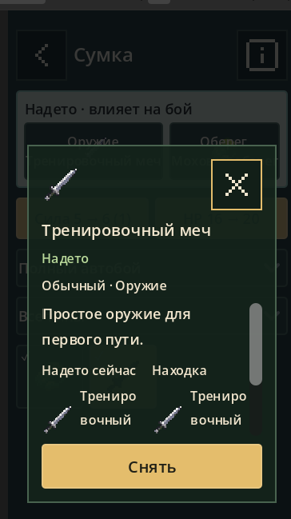
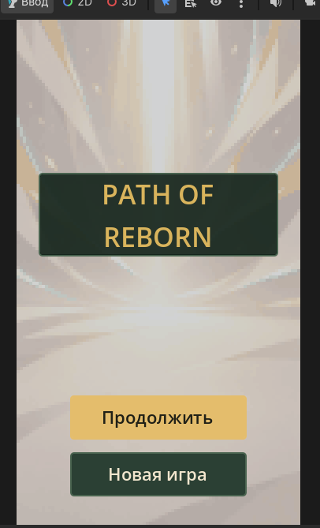
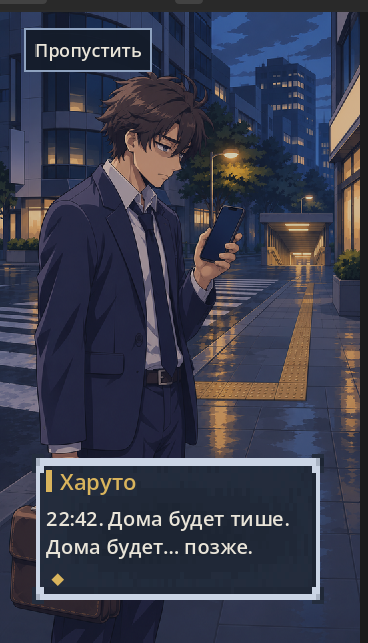
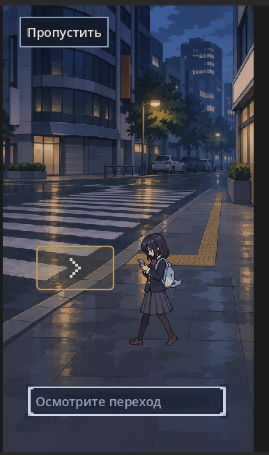
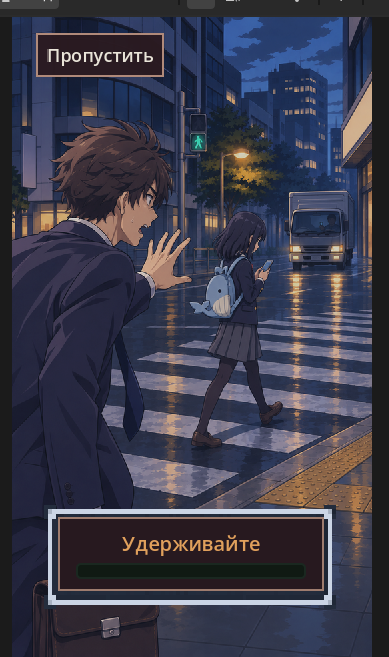
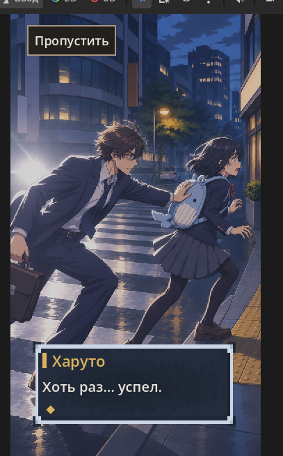
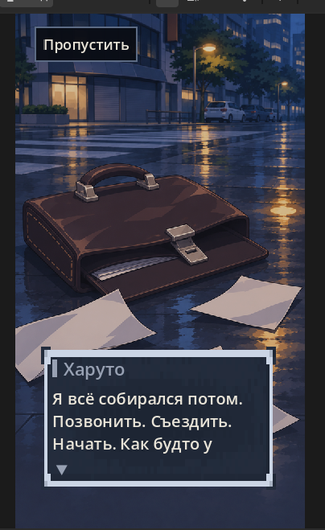
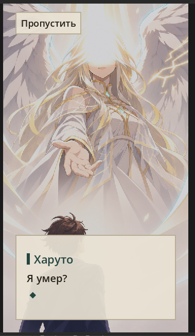
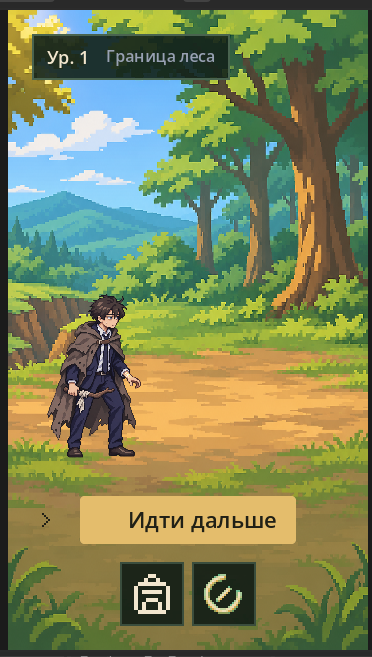

# План работы над замечаниями к интерфейсу и добыче

Дата 21 ноября 2026. Основание — замечания владельца проекта и 12 приложенных снимков. План предназначен для текущей ветки Path of Reborn с накопленными изменениями первой сессии. [Последний повторный прогон](../first_session_reaudit_2026_11_21/README.md)

Три внешних снимка Path of Kings хранятся локально в `references/path-of-kings/feedback_2026_11_21/`. Ниже зафиксировано, какие решения компоновки из них взяты. [Источник референса](../../../references/path-of-kings/README.md)

## Кого запускать

1. **Kimi первым.** Передай промпт и этот файл. В общем репозитории картинок достаточно по ссылкам. Kimi меняет Godot UI, ввод и игровые правила, примеряет существующий логотип, использует имеющиеся иконки и даёт кадры рабочей компоновки. На выходе ты получаешь короткий список недостающих изображений, их размеры и снимки, на которых их надо проверить. [Промпт Kimi](../../design/KIMI_UI_GAMEPLAY_FEEDBACK_PROMPT_2026_11_21.md)
2. **ChatGPT после первых кадров Kimi.** Передай ему арт-промпт, список из первого прохода и нужные PNG из таблицы в промпте. Если это отдельный чат без доступа к репозиторию, прикрепи файлы как вложения. Дай точное написание логотипа, если требуется правка названия. Получи чистые PNG, мастера, превью и сведения об альфа-канале. [Промпт ChatGPT](../../art/CHATGPT_UI_GAMEPLAY_FEEDBACK_PROMPT_2026_11_21.md)
3. **Kimi снова для подключения и проверки.** Передай выбранные PNG и сведения об экспорте. Kimi подключает их через проектный манифест, повторяет тесты, собирает кадры до/после и прогоняет первую сессию на изолированном профиле. При технических замечаниях он возвращает ChatGPT ссылку на конкретный PNG, ожидаемый размер, кадр дефекта и описание одной правки. [Пайплайн ассетов](../../art/AI_ASSET_PIPELINE.md)

Первый проход Kimi определяет размеры карточек, диалога, слотов и значков в реальном viewport. Это позволяет заказывать арт только там, где существующие файлы и тема Godot оставляют конкретный пробел. Вопросы к владельцу собраны ниже. Независимые задачи Kimi идут параллельно с выбором названия.

## Что передавать между проходами

| От кого → кому | Что передать | Признак готовности |
| --- | --- | --- |
| Ты → Kimi | Промпт, этот план, исходные рисунки 1–12 | Kimi видит текущую ветку и знает, какие части скриншотов относятся к требованиям |
| Kimi → ChatGPT | Скриншоты меню, Токио и Порога, hold, World и карточек. Для каждого пробела — роль, ID, рабочий PNG/референс, точные размеры, отступы, срезы и прозрачность | Каждый запрошенный файл можно примерить на конкретном кадре и в реальном размере. Название для правки логотипа указано явно |
| ChatGPT → Kimi | Отдельные экспорты, мастера, композиты, исходник/инструмент, статус и результаты проверки | Экспорты соответствуют оговорённой геометрии и готовы к проверке импорта |
| Kimi → тебе | Кадры по исходным замечаниям и результаты smoke/регрессий | Можно проверить Title, пролог, мир, рюкзак, бой, свайпы, монеты, развитие и загрузку на одном маршруте |

Текст для старта Kimi можно отправить вместе с файлами: «Выполни первый проход по приложенному промпту. В конце подготовь кадры и список конкретных изображений для ChatGPT, продолжай независимые правки кода, которые не ждут графику».

## Точки для решения и рабочие гипотезы

- **Название.** Готовый прозрачный PNG несёт текст **A Road Unwritten** и имеет статус кандидата. Просьба подключить логотип относится к главному меню. Выбор текста для финального экспорта остаётся открытым. [Прозрачный логотип](../../../art_working/title_logo_2026_11_20/a_road_unwritten_logo_v01.png) · [Статус и примерки](../../art/TITLE_LOGO_REVIEW_2026_11_20.md)
- **Компоновка.** Предложено поставить уровень и локацию вертикальной стопкой в центре верхней строки, монеты справа. Слоты предложено начать с сетки 4×2. Видимые размеры знаков, высоту диалога и touch-зоны уточнит Kimi по живым кадрам.
- **Управление.** Предложено использовать свайп влево для рюкзака, вправо для надевания, `×1/×2` для автобоя и отдельные намеренные атаки/уклонения для ручного режима. Кристалл хранится одним доступным действием. Компактные кнопки дублируют жесты.
- **Добыча и первый меч.** Монстры оставляют Кристаллы Эха. Первый меч вручает Дайдзиро после знакомства как благодарность за помощь и победу над гоблином-лазутчиком у телеги. До этого Харуто дерётся прутом. Текущий сценарий описывает более позднюю покупку меча в Лиорене. При реализации нужно согласовать дорожную награду и события магазина с новым решением. [Первая награда маршрута в текущем коде](../../../game/data/route/forest_slice.json) · [Текущий сценарий](../../narrative/Path_of_Reborn_Story.md)
- **Экономика.** Цены остальных кристаллов и действие продажи у Дайдзиро — рабочие предложения. Продажа отделена от получения добычи. [Валюта и кристаллы в каноне](../../narrative/Path_of_Reborn_Narrative_Bible.md)
- **Развитие и озвучка.** Навыки по уровням, выбор полученных фамильяров у Харуто и развитие собственного фамильяра у спутников — требования. Конкретные способности, пороги, первые фамильяры и доступные звуковые дорожки нужно выбрать по контенту. Промпт Kimi предусматривает проверяемую реализацию на данных и пустые состояния, где игровой контент ещё не выдан. [Аудиобриф](../../art/FIRST_SESSION_AUDIO_BRIEF_2026_11_21.md)

## Скриншоты и замечания

### 1. Карточка в сумке

Слишком крупные закрытие и действие. Название должно быть сверху, иконка — центром карточки. Две узкие колонки сравнения обрывают название.

### 2. Главное меню

Видна текстовая плашка рабочего названия. Поставить прозрачный логотип, проверить кнопку «Продолжить» на светлом фоне.

### 3–4. Диалог в Токио и осмотр перехода

Заменить «Пропустить» значком справа сверху. Увеличить ширину диалога, опустить панель, уменьшить шрифт, сделать единую тонкую кромку и полупрозрачную подложку. Сохранить осмотр перехода.

 

### 5–6. Удержание и спасение

Показать знак руки, подпись «Спасти» и прогресс удержания. Кнопка пропуска и оформление диалога Харуто сохраняют один цвет через смену плана.

 

### 7–8. Портфель и сцена с Мицуки

Использовать прежнюю общую форму, цвет и габарит панели для Харуто. Длинный текст в сцене с портфелем и «Я умер?» на светлом фоне проверяют пагинацию и контраст в одной геометрии.

 

### 9. Первый выход в мир

Уровень и территория в две компактные строки по центру HUD. Шестерёнка слева, монеты справа. Восемь слотов снаряжения над нижним меню из Печати, рюкзака и персонажей.

### 10. Референс плотности мира

Из снимка берём размещение верхней строки, слотов и нижней навигации. Конкретные разделы Path of Reborn, графика и состав слотов определены нашим промптом.

### 11. Референс карточек и сравнения

Название, иконка, уровень и стрелки сравнения помогают считать параметры. В Path of Reborn хранение и надевание управляются свайпами. Кристалл показывает цену и отправляется в рюкзак.

### 12. Референс сокращения монет

Верхняя строка иллюстрирует размещение баланса справа и сокращение `K`. Для своих больших значений используем подгонку формата и доступ к точному числу.
